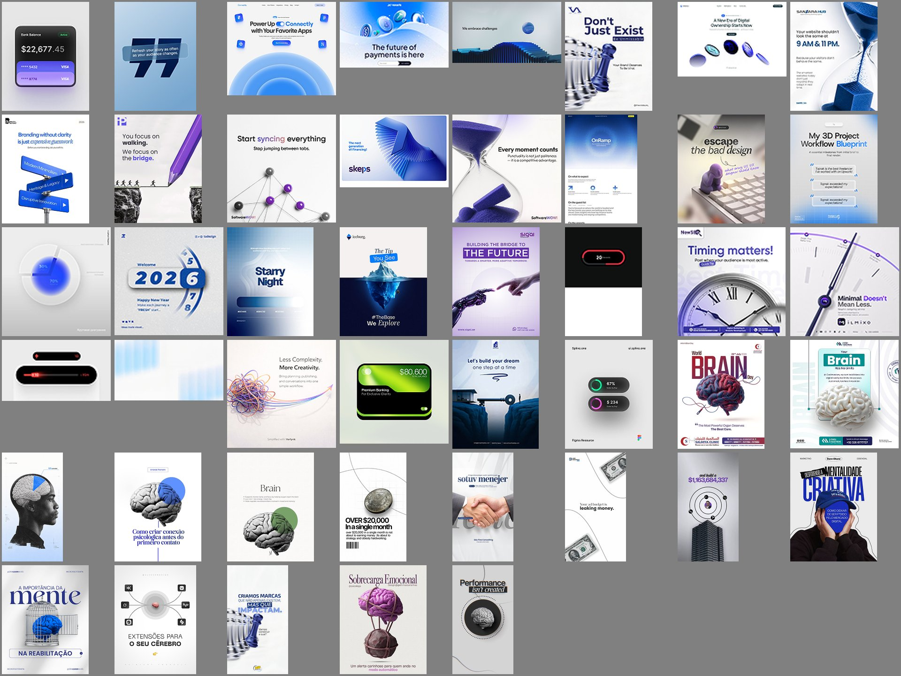
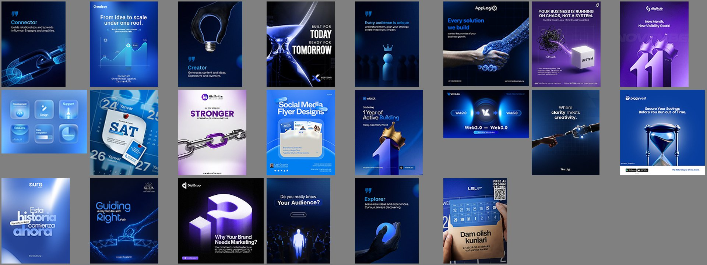
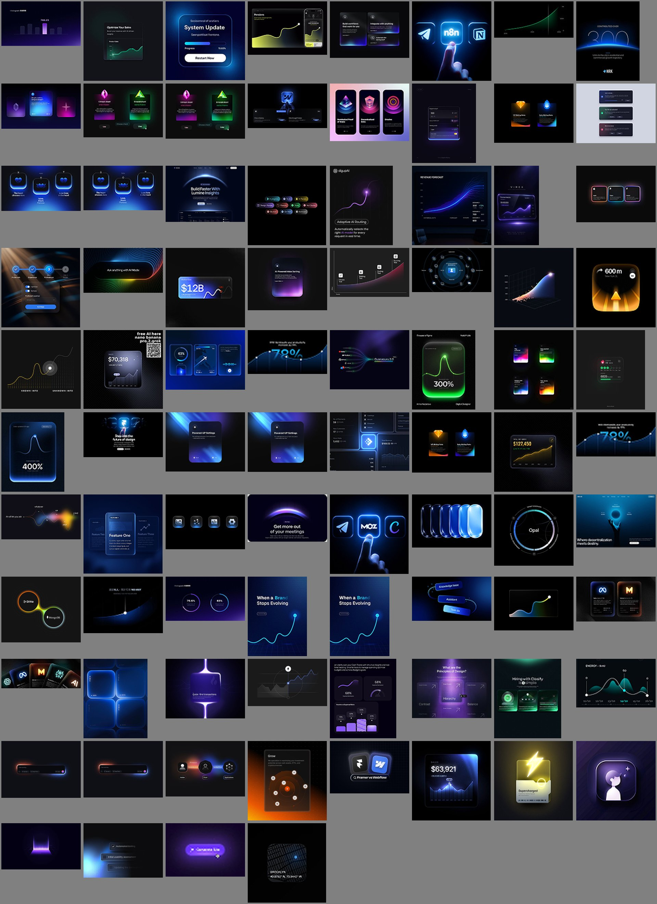
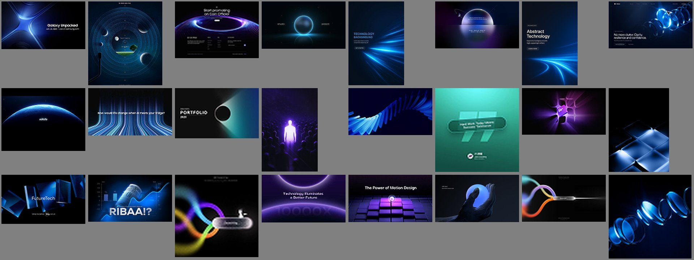

# 01: UI & Design Inspiration Board (175 references)

Nikhil ne ek zip me 175 reference images bheje: *"Clean modern white design inspiration, UI inspiration, reference"*.

Saari images 4 folders me baanti gayi hain: `assets/ui-board/<category>/NNN.png`. Har category ka ek board (sab images ek saath) bhi bana hai.

| # | Category | Kitni | Board |
|---|----------|-------|-------|
| 1 | Light minimal (white) | 45 | [board](assets/board-1-light-minimal.jpg) |
| 2 | Bright brand posters (blue/purple) | 22 | [board](assets/board-2-bright-brand-posters.jpg) |
| 3 | Dark glow UI | 84 | [board](assets/board-3-dark-glow-ui.jpg) |
| 4 | Abstract backgrounds | 24 | [board](assets/board-4-abstract-backgrounds.jpg) |

> **Dhyan dene wali baat:** folder ka naam "white design" hai, par aadhe se zyada references (84 + 24) **dark glow** style ke hain. Sirf ~45 sach me white/light hain. Dono ke rules neeche alag likhe hain, taaki kaam ke time sahi wala chuna ja sake.

## Puri collection ka DNA (sab me common)

1. **Ek hi hero:** har design me ek main cheez. Object, number, card ya headline. Baaki sab chhota aur shaant.
2. **Blue + violet family:** electric blue (~`#2F6BFF`) aur violet (~`#7B4DFF`) sabse zyada. Kabhi kabhi neon green ya orange accent.
3. **3-tone rule:** white/black + ek accent color. Video editing Lesson 06 wala hi rule, yahan bhi.
4. **Bahut saari khaali jagah (whitespace).** Text chhota, hero bada.
5. **Depth:** soft shadows, glow, glass blur. Kuch bhi flat nahi.

---

## 1. Light minimal (white): 45 references

Is category me 2 sub-styles hain:

### 1A. Clean product / SaaS white
*(Examples: "Start syncing everything", "Every moment counts", "Less Complexity. More Creativity.", "Minimal Doesn't Mean Less", Connectly, OnRamp, Bank Balance card)*

| Element | Kaise |
|---------|-------|
| Background | Off-white / very light grey (`#F4F4F6` – `#ECECEF`), kabhi neeche se halka blue gradient |
| Hero | Ek **3D ya real object**: hourglass, chess piece, pencil, pins, clock, coins. Accent color (blue/purple) me |
| Headline | Chhota-medium sans, dark grey. **Ek word accent color me** ("syncing", "bridge", "Doesn't") |
| Lines | Patli curves, orbit circles, connector lines, objects ko jodti hui |
| Shadow | Bahut soft, neeche phaili hui. Objects zameen par "baithe" lagte hain |
| UI pieces | Frosted/neumorphic pills, toggle, progress ring. Soft inner shadow ke saath |

### 1B. Editorial halftone poster
*(Examples: brain posters, "Performance isn't created", "OVER $20,000 In a single month", "Your ad budget is leaking money", chess "Don't Just Exist", "A importância da mente")*

Ye bilkul **video editing Lesson 05–06 wala style** hai, static poster me:
- **Black & white halftone cutout** (brain, coin, chess, person ka sir)
- Uske **peeche ek color circle** (green, blue) ya color se bhara ek hissa (brain ka ek part blue)
- **Mixed fonts:** bold sans + italic serif ek hi headline me ("Branding without clarity is just *expensive guesswork*", "escape *the bad design*")
- **Label box highlight:** ek word box ke andar ("The Tip **[You See]**", "Performance **[isn't created]**", "**[MAS QUE]**", "**[THE FUTURE]**")
- Patli lines jo frame ke bahar tak jaati hain, aur aadhe kate objects edges par (depth)

---

## 2. Bright brand posters: 22 references

*(Examples: Cloudpso "From idea to scale", "Every solution we build", Creator / Connector / Explorer quote cards, "Why Your Brand Needs Marketing?", "1 Year of Active Building", "Guiding every step toward Right Path")*

- Background: **royal blue → navy gradient**, ya violet → deep purple
- Hero: **3D glossy object** jo concept dikhaye: chain link (connector), bulb (creator), crown (#1), ghanta-ghadi (time), haath milana (partnership)
- **Quote cards series:** bada `"` icon, ek word heading accent me (Connector, Creator, Explorer), neeche 2 line description. Ek series ke saare cards same layout me.
- Headline me ek word **halka/bright** blue me, baaki white
- Brand logo upar kone me, website/handle neeche: social post format

---

## 3. Dark glow UI: 84 references

Sabse badi category. Ye **app/web UI shots** hain, ya UI ko poster banake dikhaya gaya hai.

| Element | Kaise |
|---------|-------|
| Background | Almost black (`#07080C` – `#0E1016`) ya deep navy |
| Cards | **Glassmorphism**: semi-transparent, blur, patla light border (1px, 10–20% white) |
| Glow | Card ke edge par **rim light** (neeche ya ek side se), blue/violet/green neon |
| Hero numbers | Bade numbers: $22,677.45, $12B, 300%, 400%, 78%. White, chart ke saath |
| Charts | Smooth curve line, neeche gradient fill jo fade ho jaata hai, end par **glowing dot** |
| Icons | Glossy **squircle** buttons (rounded square), andar se glow. Ungli button dabati hui (n8n, MOZ) |
| Text | Chhota, light grey, bahut kam. Glow aur shapes hi baat karte hain |

**Common layouts:**
- Ek bada card beech me, peeche glow (dashboard / balance / settings)
- 2–3 cards side by side, har ek ka alag neon color (pink/green, orange/blue)
- Icons ki row, beech wala highlight (active)
- Search / prompt bar, rainbow ya neon edge ke saath ("Ask anything with AI Mode")

---

## 4. Abstract backgrounds: 24 references

*(Examples: "Technology background" light streaks, planet horizon glow, glass spirals, blue tiles, light beams, ribbon loops)*

- **Horizon glow:** grah (planet) ka kinara, upar se light. Hero text uske upar ("Build Faster With Lumine Insights")
- **Light streaks / speed lines:** blue, ek kone se doosre kone tak
- **3D glass shapes:** spiral, rings, tiles, glossy aur transparent
- Use: website hero section, slide background, ya video intro

---

## Kaunsa style kab use kare

| Kaam | Style |
|------|-------|
| Instagram educational / brand post (premium, clean) | **1B Editorial halftone** |
| SaaS / app landing page, pricing, product post | **1A Clean product white** |
| Brand quote cards series, announcements | **2 Bright brand posters** |
| Fintech, AI tool, dashboard UI, tech product | **3 Dark glow UI** |
| Website hero, slide background, video intro | **4 Abstract backgrounds** |

## Clean white design ke liye quick recipe

1. BG: `#F5F5F7`, upar halka grain (3–5%)
2. Ek hero object (3D ya halftone cutout), frame ke beech ya ek side me, soft shadow ke saath
3. Headline: sans (Inter / Satoshi / General Sans) dark grey `#1A1A1A`, **ek word** accent me (`#2F6BFF` blue ya `#7B4DFF` violet), ya italic serif me
4. Ek patli line ya orbit circle jo hero ko layout se jode
5. Chhoti details: logo upar kone me, handle neeche. Font chhota.
6. Sirf 3 colors: white, dark, ek accent

*(Hex values aur font names mere suggestions hain, images se andaze ke hisaab se.)*
