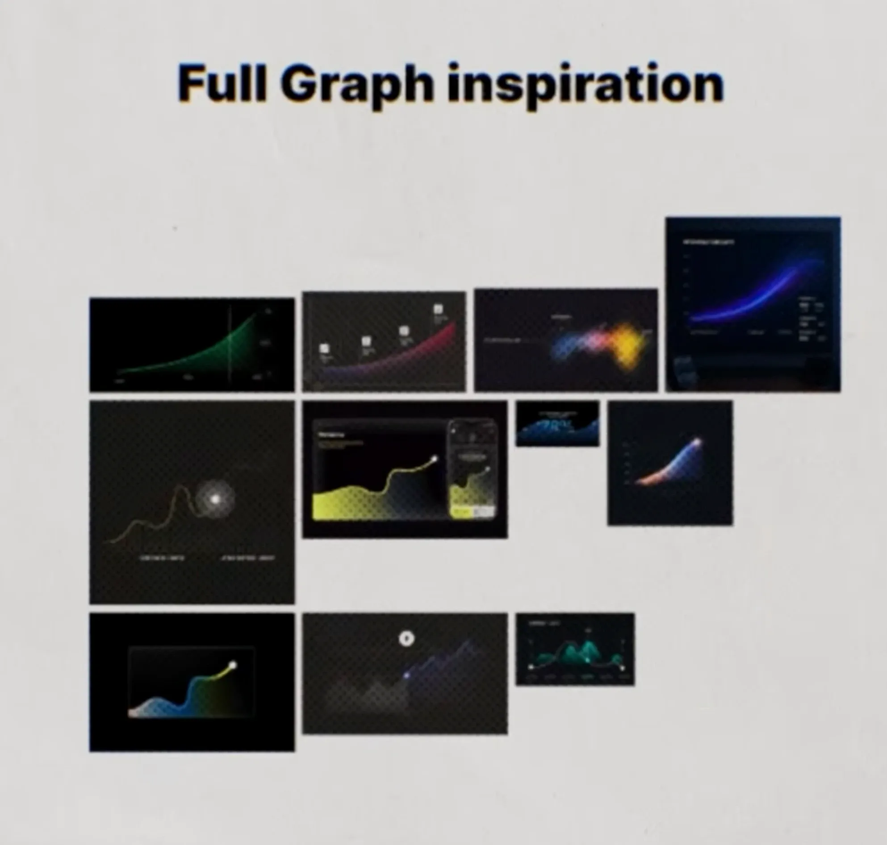
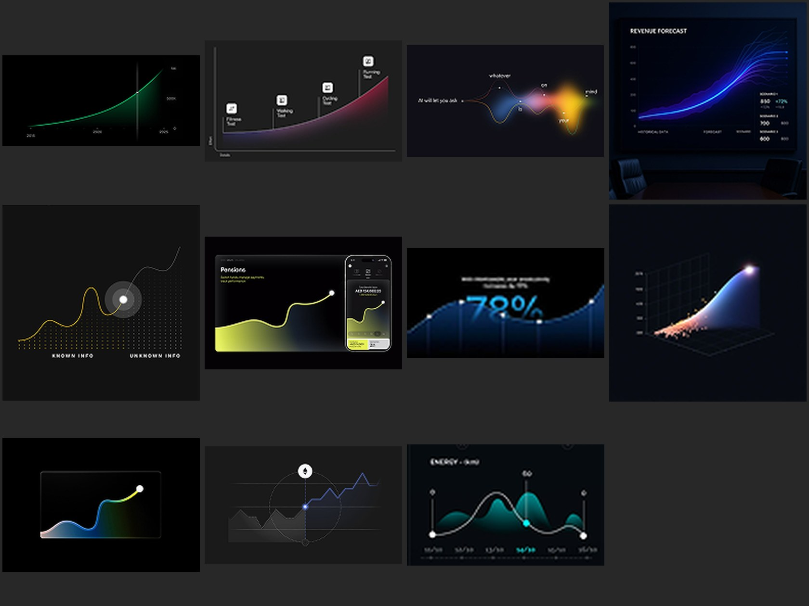

# 02: Full Graph Inspiration (animated charts)

Creator ki "Full Graph inspiration" slide me 11 graphs hain. **Ye saare 11 Nikhil ke zip (lesson 01 board) me already the.** Matlab wo zip isi creator ki inspiration library thi.

Zip se saaf versions:

| # | Graph | Zip file |
|---|-------|----------|
| 1 | Green exponential curve, vertical marker line | `ui-board/3-dark-glow-ui/008.png` |
| 2 | Red/purple area curve, steps par icons + labels (Fitness → Walking → Cycling → Running) | `048.png` |
| 3 | "AI will let you ask whatever is on your mind": words ek wave par, rainbow blur | `095.png` |
| 4 | Revenue forecast: kai blue lines fan out (scenarios), side me numbers | `039.png` |
| 5 | Known info → Unknown info: yellow line, dot grid, glowing circle "abhi" par | `059.png` |
| 6 | Pensions: yellow area chart, laptop + phone mockup | `004.png` |
| 7 | 78%: bada number blue wave ke andar, points par white dots | `094.png` |
| 8 | 3D chart: particles se smooth surface, top par glow | `054.png` |
| 9 | Glass card me rainbow gradient area, end par white dot | `128.png` |
| 10 | Grey past data → blue future data, beech me circle marker + icon | `134.png` |
| 11 | Energy: teal mountain area + white line, selected point highlighted | `144.png` |

## Graph design ke rules (sab 11 me common)

1. **Dark background** (`#05060A` – `#141418`). Graph hi akela roshni ka source hai.
2. **Axes aur grid lagbhag gayab:** bahut patle, 5–15% opacity. Labels chhote, grey.
3. **Ek smooth line** (curved, sharp kone nahi), uske neeche **gradient area fill** jo neeche jaate jaate transparent ho jaaye.
4. **Glowing end dot:** line ke end ya "abhi" wale point par white dot + halo. Aankh wahin jaati hai.
5. **Gradient color line ke saath badalta hai:** start dim/thanda, end bright/garam (blue → yellow, purple → red). Growth ka feel aata hai.
6. **Ek hi bada number ya message** graph ke saath (78%, Revenue Forecast). Baaki text bahut chhota.
7. **Story wala graph:** past vs future (grey → color, known → unknown), ya steps par icons. Graph sirf data nahi, ek kahani batata hai.

## Graph types: kab kaunsa

| Baat kya hai | Graph |
|--------------|-------|
| Tezi se growth ("exponential", "compounding") | 1. Exponential curve + marker |
| Ek journey ke steps | 2. Area curve + icons on steps |
| Abstract idea / AI / emotion | 3. Words on a wave, blur color |
| Future ke possibilities | 4. Fan-out lines |
| Pata hai vs nahi pata | 5. Known → unknown, dot grid |
| Product / app feature | 6. Chart + device mockup |
| Ek stat dikhana hai | 7. Bada number wave me |
| "Data bahut zyada hai", premium tech feel | 8. 3D particle surface |
| Simple growth, clean | 9. Glass card + gradient area |
| Pehle vs ab / past vs prediction | 10. Grey past → colored future |
| Ups and downs, selected din | 11. Mountain area + highlighted point |

## Animate kaise kare (mere suggestions)

1. **Line draw-on:** line left se right banti hai (AE: Trim Paths 0 → 100%; CapCut: mask wipe). 1–1.5s, ease-out.
2. **Area fill reveal:** line ke peeche fill neeche se fade ya wipe hota hai, 4–6 frames delay se.
3. **Dot travel:** glowing dot line ke saath chalta hai aur end par ruk ke **halo pulse** karta hai (scale 100 → 130%, opacity 60 → 0%).
4. **Number counter:** bada number 0 se count up karta hai (78%, $12B), line ke saath sync me.
5. **Labels / icons pop:** jab dot kisi step par pahunche, wahan ka icon pop (Lesson 02 ka rise + fade + blur).
6. **Camera:** poore graph par halki slow push-in (100 → 106%), ya 3D graph ho to thoda rotate.
7. Kul time **2–3 second**, phir agla scene.

## Video editing lessons se link
- Video Lesson 05 ka "Graphic centric" scene type, aur Lesson 06 ka "focal point": graph = hero, bada number = support, grid/labels = depth.
- Light/white version chahiye to rules same rakho, sirf BG off-white aur line accent color (3-tone rule).
