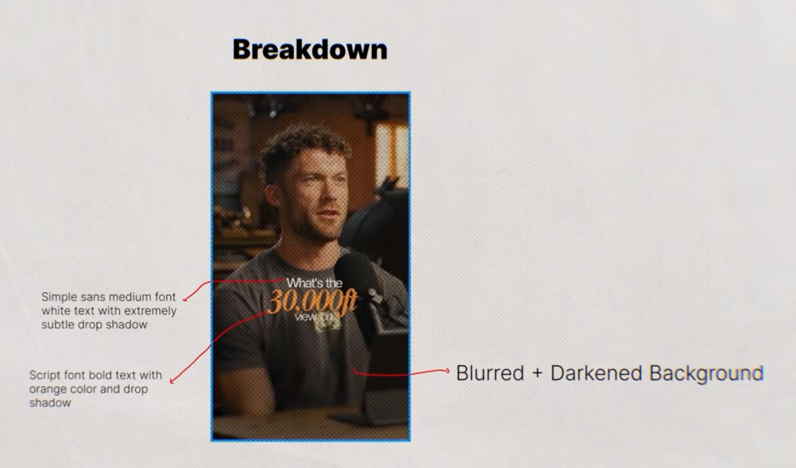

# 01: Podcast Reel Caption Style



**Format:** 9:16 vertical podcast clip (Reels / Shorts / TikTok)
**Example text:** "What's the **30,000ft** view on..."

## Breakdown: kya dikh raha hai

Is style ki 3 layers hain:

| Layer | Kya hai | Details |
|-------|---------|---------|
| 1. Normal words | Simple sans font, medium weight | White, chhota size, **bahut halka** drop shadow |
| 2. Keyword | Script / italic font, bold | **Orange**, normal words se lagbhag 2x bada, drop shadow |
| 3. Background | Speaker wala video | **Blurred + darkened**, taaki text pop kare |

Extra cheezein jo frame me dikhti hain:
- Warm color grade: browns, oranges, aur tungsten lights.
- Halki halftone/dot grain texture puri video ke upar.
- Text center me, frame ki height ke 55–65% par (chest level). Face cover nahi hota.

## Ye kyun kaam karta hai

- **Contrast of fonts:** sans font padhne me easy hai. Script font ek "emotion" ya "important" word ko highlight karta hai. Viewer ki aankh seedha keyword par jaati hai.
- **Ek hi accent color:** sirf keyword orange hai, baaki sab white. Isse hierarchy clear rehti hai.
- **Color match:** orange background ke warm tones se match karta hai, isliye bahar ka nahi lagta.
- **Blur + dark BG:** text ke peeche distraction kam hota hai aur readability badhti hai, bina koi box ya pill lagaye.
- **Subtle shadow:** white text par shadow sirf itna ho ki light areas par bhi padha jaaye. Zyada shadow cheap lagta hai.

## Kaise banaye (step by step)

### 1. Background
- Video clip par **Gaussian Blur** lagao: 15–25 (Premiere) / CapCut me Blur ~20–30.
- Darken karo:
  - Exposure/Brightness `-0.5` se `-1` stop, **ya**
  - Upar ek black solid layer, opacity **30–40%**.
- Optional: halftone ya grain overlay, opacity 10–20%, blend mode *Overlay / Soft Light*.
- Tip: blur poore clip par nahi, sirf usi moment par lagao jab ye big caption aata hai (hook ya key line). Baaki time normal video chale.

### 2. Normal words (sans)
- **Font:** Inter Medium / SF Pro Display Medium / Helvetica Neue Medium / Montserrat Medium
- **Color:** `#FFFFFF`
- **Size:** keyword ka lagbhag 40–50%
- **Drop shadow:** black, opacity 20–30%, distance 1–2px, blur/softness 4–8px

### 3. Keyword (script)
- **Font options:** Playfair Display Bold Italic, Instrument Serif Italic, Bodoni Bold Italic, ya koi bold brush/script font
- **Color:** warm orange, around `#E8923A` (range `#E07B2A` – `#F2A54A`)
- **Size:** normal words se ~2x
- **Drop shadow:** black, opacity 50–60%, distance 3–4px, blur 8–12px
- Letter spacing thoda tight (-1 se -2%) taaki compact lage.

### 4. Layout
- 3 lines ka stack, sab **center aligned**:
  ```
  What's the        ← sans, white, small
  30,000ft          ← script, orange, BIG
  view on           ← sans, white, small
  ```
- Lines ke beech gap kam rakho. Keyword thoda upar wali aur neeche wali line ko overlap kar sakta hai.
- Position: vertical center se thoda neeche, mic ya face ko cover na kare.

### 5. Animation (recommended)
- Words ek-ek karke aaye (word-by-word, speech ke saath sync).
- Keyword par chhota **scale pop** (90% se 105% se 100%, ~6–8 frames) ya fade + slight upward slide.

## Kab use kare
- Hook line ya video ka sabse important statement.
- Har caption me nahi. Ek clip me 1–3 baar, warna effect khatam ho jaata hai.

## Tools
- **Premiere Pro:** Essential Graphics (text + shadow), Gaussian Blur, Lumetri (exposure)
- **CapCut:** Text → Shadow settings, Effects → Blur, Adjust → Brightness
- **After Effects:** Text layers + Drop Shadow, Fast Box Blur / Gaussian Blur, Exposure
