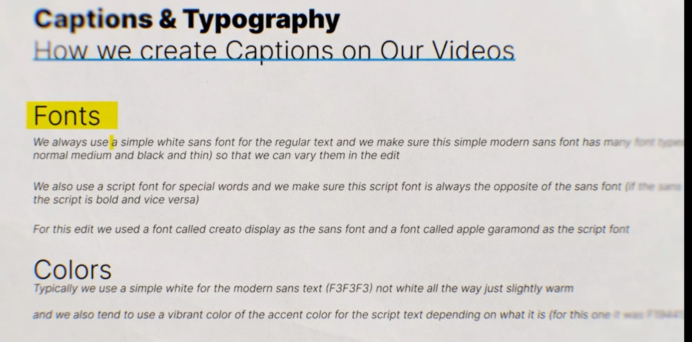
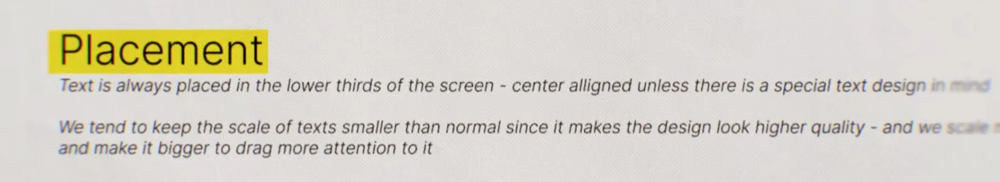
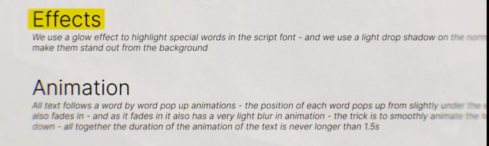

# 02: Caption & Typography System (creator ke apne rules)

Ye wahi creator hai jiska style Lesson 01 me tha. Is baar unhone apne **exact rules** bataye hain ki captions kaise banate hain. Lesson 01 me humne frame dekh ke andaza lagaya tha. Ye uska official version hai, aur jahan dono alag hain wahan **ye wala sahi maano**.

> Screenshot me kuch lines ka end blur ya cut tha. Jo hissa andaza hai, use *(andaza)* likha hai.

## 1. Fonts

**Rule A: Sans font (normal text ke liye)**
- Simple, modern, white sans font.
- Font **family** aisi lo jisme bahut saare weights hon (Thin, Normal, Medium, Black), taaki edit me weights badal ke variety la sako.

**Rule B: Script font (special words ke liye)**
- Sirf special ya keyword ke liye.
- Script font hamesha sans ka **opposite** ho: sans patla ho to script bold, aur sans bold ho to script patla.

**Is edit me use hue fonts:**
| Role | Font |
|------|------|
| Sans | **Creato Display** (free font, kai weights me milta hai) |
| Script | **Apple Garamond** (italic use karo, keyword wala look isi se aata hai) |

Alternatives (agar ye fonts na milein):
- Sans: Inter, Satoshi, General Sans, Montserrat
- Script/serif italic: EB Garamond Italic, Cormorant Garamond Italic, Playfair Display Italic

## 2. Colors

| Text | Color | Note |
|------|-------|------|
| Sans (normal) | `#F3F3F3` | Pure white `#FFFFFF` nahi. Thoda warm/soft white, aankhon ko chubhta nahi |
| Script (keyword) | `#F1944?` (orange) | Exact last digit screenshot me cut tha. `#F19441` use kar sakte ho |

- Accent color video ke hisaab se badalta hai. Hamesha **vibrant** ho aur video ke mood se match kare. Warm video ho to orange; cool video ho to cyan, teal, etc.

## 3. Placement

- Text hamesha screen ke **lower third** me.
- **Center aligned**, jab tak koi special text design plan na ho.
- Text ka scale **normal se chhota** rakho. Chhota text zyada premium aur high-quality lagta hai.
- Jis word par attention chahiye, sirf use bada karo *(andaza: "we scale up special words")*.

## 4. Effects

| Text | Effect |
|------|--------|
| Script keyword | **Glow** effect, isse highlight hota hai |
| Sans normal | **Light drop shadow**, bas itna ki background se alag dikhe |

Starting settings (mere suggestions, creator ne numbers nahi diye):
- **Glow:** accent color hi, opacity 40–60%, radius/softness 15–30px. Itna subtle ho ki "neon" na lage.
- **Drop shadow:** black, opacity 20–30%, distance 1–2px, softness 4–8px.

## 5. Animation

**Word-by-word pop-up**, har word me 3 cheezein ek saath hoti hain:
1. **Position:** word apni jagah se thoda neeche se upar aata hai.
2. **Opacity:** 0% se 100% fade in.
3. **Blur:** halka blur se sharp hota hai.

- **Trick:** animation smooth rakho. Easing ke saath end me slow down ho (ease-out) *(andaza: line cut thi)*.
- Pure text ka total animation **kabhi 1.5 second se lamba nahi**.

Starting values (mere suggestions):
| Property | Start | End | Duration |
|----------|-------|-----|----------|
| Position Y | +15 se +25px (neeche) | 0 | 8–12 frames |
| Opacity | 0% | 100% | 6–8 frames |
| Blur | 8–12 | 0 | 8–10 frames |
| Easing | | Ease-out / Easy Ease, speed graph me end flat | |
| Words ke beech gap | | 2–4 frames ka stagger, ya speech ke saath sync | |

**Tools me kaise:**
- **After Effects:** Text Animator me Position, Opacity aur Blur add karo. Range Selector "Based on Words" rakho, aur Ease High/Low se smoothing do.
- **Premiere:** har word alag layer me, keyframes par Ease Out lagao. Ya MOGRT preset use karo.
- **CapCut:** Text → Animation → In → "Fade In / Rise" type preset, phir blur ke liye keyframes.

## Quick checklist (har caption ke liye)
- [ ] Sans: Creato Display, `#F3F3F3`, light drop shadow
- [ ] Keyword: Garamond Italic, vibrant accent color, glow
- [ ] Script ka weight sans ka opposite
- [ ] Lower third, center aligned
- [ ] Size normal se chhota, sirf keyword bada
- [ ] Word-by-word: rise + fade + blur, ease-out
- [ ] Total animation ≤ 1.5s
