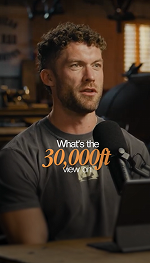
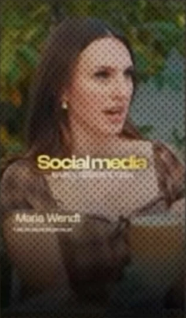
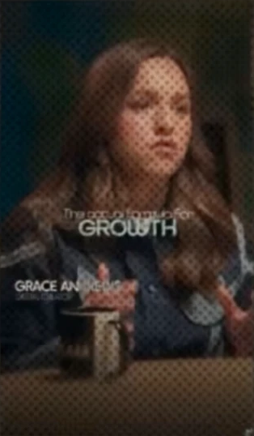
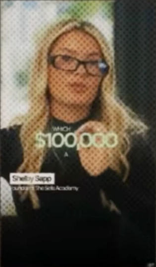
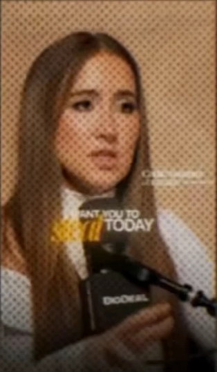

# 03: Caption Text Inspiration (9 frames ka pattern)

| | | | | |
|---|---|---|---|---|
|  |  |  |  |  |
| 1. 30,000ft | 2. Resting Heart Rate | 3. 60mins | 4. Wind Down | 5. gap between |

Lesson 02 ke rules (sans + script, glow, lower third) in sab frames me dikh rahe hain. Is lesson me naya ye hai ki **ek hi system se kitne alag layouts** bante hain.

> Frames chhote (~150px) the. Colors aur fonts andaze se likhe hain, exact nahi.
>
> Frames 6–9 Lesson 04 ke hook overview slide se crop kiye gaye hain, isliye unpar halftone dots dikhte hain.

| | | | |
|---|---|---|---|
|  |  |  |  |
| 6. Social media | 7. GROWTH | 8. $100,000 | 9. steal |

## Core formula: Setup → Payoff → Tail

Har caption me 3 role hote hain:

| Role | Style | Example |
|------|-------|---------|
| **Setup** (pehle ke words) | Chhota sans, `#F3F3F3` | "What's the", "Lower Your", "You wanna have like a" |
| **Payoff** (main idea) | BADA script/serif italic, accent color + glow | "30,000ft", "Resting Heart Rate", "Wind Down" |
| **Tail** (baad ke words) | Chhota sans, kabhi wide letter-spacing | "view on", "Before Bed" |

**Payoff kaun sa word bane?** Wahi jo viewer ko yaad rehna chahiye:
- **Numbers aur quantities:** 30,000ft, 60mins. Numbers sabse strong payoff hain.
- **Main concept ya action:** Resting Heart Rate, Wind Down
- **Emotional ya surprising phrase:** gap between

## 5 layout templates

### A. Center sandwich (frame 1, 2)
```
      What's the          ← setup, sans chhota
      30,000ft            ← payoff, script BADA
       view on            ← tail, sans chhota
```
- Sabse common, default layout.
- Frame 2 me tail "B e f o r e  B e d" ki **letter-spacing bahut wide** hai aur thoda dim hai. Isse texture aur luxury feel aata hai.

### B. Hero number, left aligned (frame 3)
```
 60mins                   ← payoff, BADA script
 Before bed Screen's off  ← chhota sans + medium sans, ek hi line me
```
- Text **left side** me hai, center me nahi. Ye Lesson 02 ka "special text design" exception hai.
- Ek hi line me **2 alag sizes**: "Before bed" chhota, "Screen's off" bada. Isse line me bhi hierarchy aati hai.
- Kab use kare: jab baat ek **rule ya instruction** ho (number + kya karna hai).

### C. Sentence + punchline (frame 4)
```
 You wanna have like a 60min   ← poori line sans, chhoti
        Wind Down              ← payoff neeche, BADA
```
- Setup ek lambi line ho sakti hai, bas chhoti rakho.
- Payoff hamesha sentence ka **last** concept hota hai. Viewer padhte padhte uspe pahunchta hai.

### D. Scattered uppercase + script (frame 5)
```
 YOU        SAID        A     ← tiny UPPERCASE sans, words door door
    gap  between              ← script BADA, overlap karta hua
```
- Setup words **ALL CAPS, tiny**, aur poori width me **failaye hue** (word-by-word pop ke saath ye bahut accha lagta hai).
- Payoff unke neeche/beech me overlap karta hai.
- Zyada editorial, magazine jaisa feel.

### E. Speaker name tag (frame 2, 5)
Do style dikhe:

**E1. Simple lower-left** (frame 2)
```
Bryan Johnson                 ← sans medium, white
Health and wellness expert    ← sans thin, chhota
```
- Bottom-left corner, chhota. Caption se clash nahi karta.

**E2. Big editorial name, text behind subject** (frame 5)
```
Marina Mogilko                ← BADA condensed serif italic, dark color
Entrepreneur                  ← tiny sans
```
- Top me, bahut bada, aur **person ka sir name ke aage hai** (text behind subject). Isse depth aur premium magazine look aata hai.
- Banane ka tarika: subject ka mask/rotoscope karo (Premiere/AE me Roto Brush, CapCut me "Remove BG" ya cutout), aur text layer subject ke peeche rakho.
- Background bright ho (din ki roshni, khidki) to name **dark color** me bhi ho sakta hai.

## Accent color video ke hisaab se badalta hai

| Frame | Background | Accent |
|-------|-----------|--------|
| 1, 3 | Warm wooden studio | Orange (~`#F19441`) |
| 2, 4 | Warm amber, moody | Peach/gold (~`#F5C27A`) |
| 5 | Green trees, daylight | Lime green (~`#B8F04A`) |

**Rule:** accent color background ke **dominant color se hi** uthao, phir use zyada saturated/bright karo. Isse text video ka hissa lagta hai, sticker jaisa nahi.

## Baaki observations
- Caption **mic ke upar aa sakta hai** (frame 3, 4). Face cover nahi karna, mic/chest chalega.
- Script payoff par **glow** saaf dikh raha hai (frame 2, 3). Lesson 02 confirm.
- Frame ka **neeche wala hissa dark** hai (vignette/gradient). Lower-third text isi wajah se saaf padha jaata hai.
- Har line **max 3–5 words**. Lambi baat ho to setup chhota karo, ya 2 captions me todo.

## Part 2: Frames 6–9 se naye patterns

| # | Text | Kya naya hai |
|---|------|--------------|
| 6 | **Social media** / *is very different now* + name tag "Maria Wendt" | Payoff **bold sans** hai (gold/yellow accent me), aur tail **patla italic serif**. Lesson 02 ka "opposite weight" rule ulta bhi chalta hai |
| 7 | *The actual formula for* / **GROWTH** + "GRACE ANN…" | **Monochrome**: koi accent color nahi. Payoff sirf ALL CAPS aur bade size se alag dikhta hai. Cool/blue video me white hi best laga |
| 8 | WHICH / **$100,000** / A… + "Shelby Sapp" | **Money number** hero hai, white/cream serif me glow ke saath. Setup aur tail tiny UPPERCASE |
| 9 | I WANT YOU TO / ***steal*** / TODAY + "Codie Sanchez" | Ek hi **power verb** script me, accent color me. Name tag **head ke paas side me**, lower-left me nahi |

### F. Inverted pair (frame 6)
```
 Social media             ← payoff: BOLD sans, bada
 is very different now    ← tail: thin italic serif, chhota
```
- Jab keyword khud ek normal phrase ho (koi "fancy" word nahi), to use bold sans me rakho aur baaki line ko elegant italic me.

### G. Monochrome caps (frame 7, 8)
```
 The actual formula for   ← tiny sans
 GROWTH                   ← BADA, ALL CAPS, white
```
- Accent color ke bina bhi hierarchy sirf **size + caps + weight** se ban jaati hai.
- Kab use kare: jab video ke colors already busy hon, ya serious/corporate tone ho.

### Name tags: total 4 jagah dikhe
- **Lower-left** (Maria, Grace, Shelby, Bryan). Sabse common, safe default.
  - Shelby wale tag me naam ek **white box/label** ke andar hai (dark text). Ye ek aur variation hai.
- **Head ke bagal me** (Codie). Zyada personal feel.
- **Top me bada, subject ke peeche** (Marina). Sabse premium.
- Format hamesha same: **Naam** (medium/bold, ya CAPS) + neeche **tiny role line** (thin).

### Part 2 ke rules
1. **Tiny UPPERCASE setup** bahut common hai (WHICH, I WANT YOU TO, YOU SAID A). Payoff ke saath size ka contrast bahut strong ho jaata hai.
2. **Payoff ek hi word bhi ho sakta hai**: GROWTH, steal. Jitna chhota payoff, utna punchy.
3. Hero ke liye best: **number, paisa, power verb**, aur main concept.
4. Accent color optional hai. Glow + size + caps bhi kaafi hain.

## Quick decision guide
| Situation | Layout |
|-----------|--------|
| Normal key line | A. Center sandwich |
| Number + rule / tip | B. Hero number, left |
| Lambi sentence, end me main word | C. Sentence + punchline |
| Dramatic / emotional quote | D. Scattered uppercase |
| Speaker ka intro (pehle 3 sec) | E1 simple, ya E2 premium |
| Keyword normal phrase hai, fancy word nahi | F. Inverted pair |
| Serious tone ya busy colors | G. Monochrome caps |
| Ek power word ("steal", "stop", "never") | D ya G, tiny CAPS setup ke saath |
