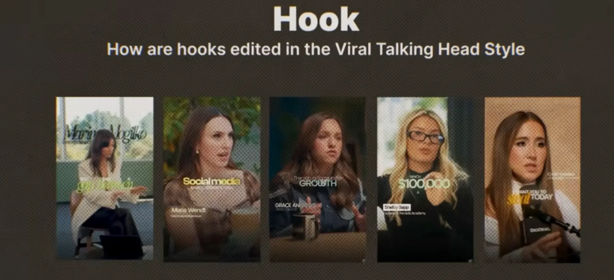
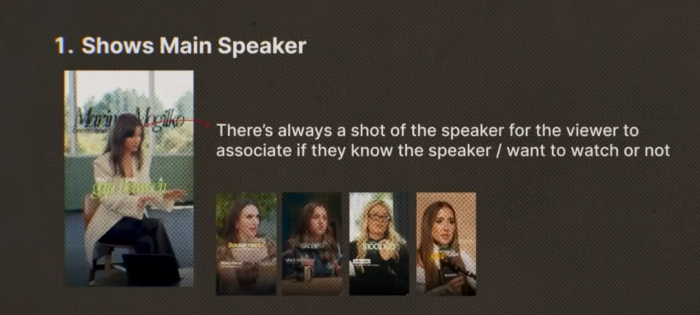
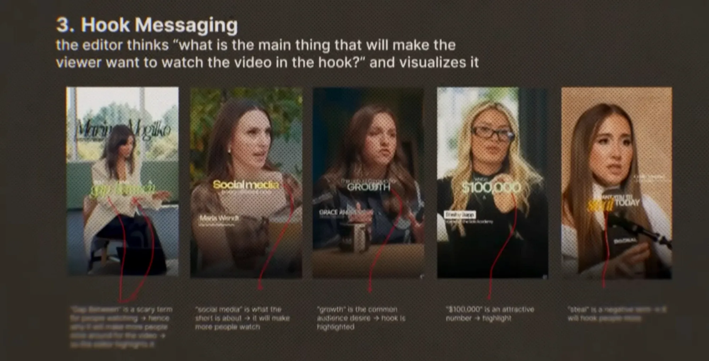

# 04: Hook Editing: Viral Talking Head Style

Pehle 2–3 second (hook) me hi viewer decide karta hai ki video dekhega ya scroll karega. Is lesson me creator bata raha hai ki hook ko edit kaise karte hain.

> Point **2** ki slide abhi nahi mili, sirf 1 aur 3 aaye hain. Point 2 milte hi yahan jod dunga.

## 1. Main speaker dikhao

**Rule:** hook me hamesha speaker ka saaf shot hota hai.

**Kyun:** viewer turant decide kar leta hai:
- "Main inhe jaanta hoon" → ruk jaata hai.
- "Ye kaun hai, kya bolne wale hain?" → curiosity se ruk jaata hai.
- "Ye mere kaam ka nahi" → scroll. Ye bhi theek hai, galat audience ka time waste nahi hota.

**Kaise karo:**
- Pehle frame me hi speaker ka chehra, medium ya close shot me. Hook me B-roll se shuru mat karo.
- **Name tag** hook me hi lagao (naam + chhoti role line). Lesson 03 ke name tag styles dekho.
- Sabse premium version: naam bada, speaker ke **peeche** (Marina Mogilko wala).

## 3. Hook messaging: ek word jo video bechta hai

Editor khud se poochta hai:
> **"Hook me wo kaunsi ek cheez hai jo viewer ko ye video dekhne pe majboor karegi?"**

Phir usi word ko **visualize** karta hai: bada, accent color, glow (Lesson 02–03 ka payoff style).

### Creator ke 5 examples, aur unke peeche ki psychology

| Highlighted word | Kyun chuna | Trigger |
|------------------|-----------|---------|
| **gap between** | Dekhne wale ke liye ye ek *darawni* term hai, isliye log ruk ke poora video dekhenge *(slide ka text blur tha, andaza)* | **Dar / problem** |
| **Social media** | Short isi topic par hai. Topic dikhte hi sahi log rukte hain | **Topic clarity** |
| **GROWTH** | Audience ki common **chahat** (desire) | **Desire** |
| **$100,000** | Attractive number, isliye highlight | **Paisa / number** |
| **steal** | Negative term hai, isliye log zyada hook hote hain *(text thoda blur tha)* | **Negative / controversy** |

### Payoff word chunne ke 5 triggers
1. **Dar ya problem:** gap, mistake, losing, broke, risk
2. **Topic:** video kis baare me hai (social media, investing, fitness)
3. **Desire:** growth, freedom, confidence, rich
4. **Number ya paisa:** $100,000, 60mins, 3x, ₹1 crore
5. **Negative ya controversial word:** steal, never, stop, lie, wrong

**Process (har hook ke liye):**
1. Hook line ka transcript likho.
2. Har important word ke saamne upar wala trigger likho.
3. Jo word sabse strong trigger de, **sirf wahi** payoff banega. Ek hook me ek hi payoff.
4. Baaki words setup/tail ki tarah chhote rakho (Lesson 03 ke layouts).

## Hook checklist
- [ ] Pehle frame me speaker ka chehra
- [ ] Name tag + role line
- [ ] Ek payoff word, 5 triggers me se kisi ek ke hisaab se chuna hua
- [ ] Payoff: bada, accent color, glow
- [ ] Word-by-word animation, ≤ 1.5s (Lesson 02)
- [ ] Point 2 *(pending)*
