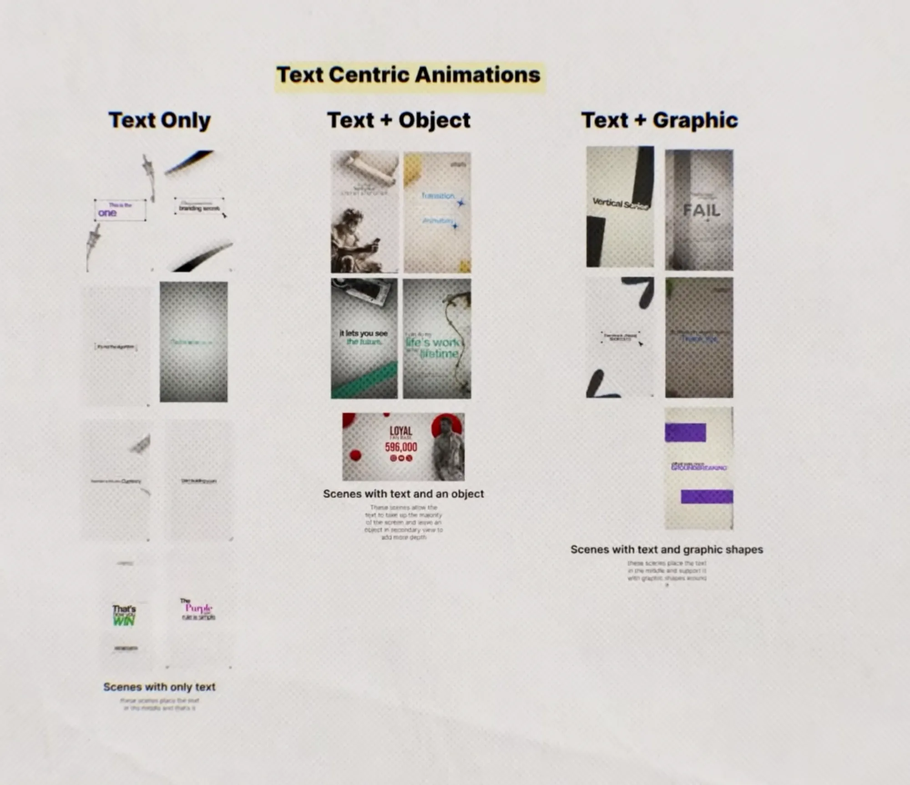
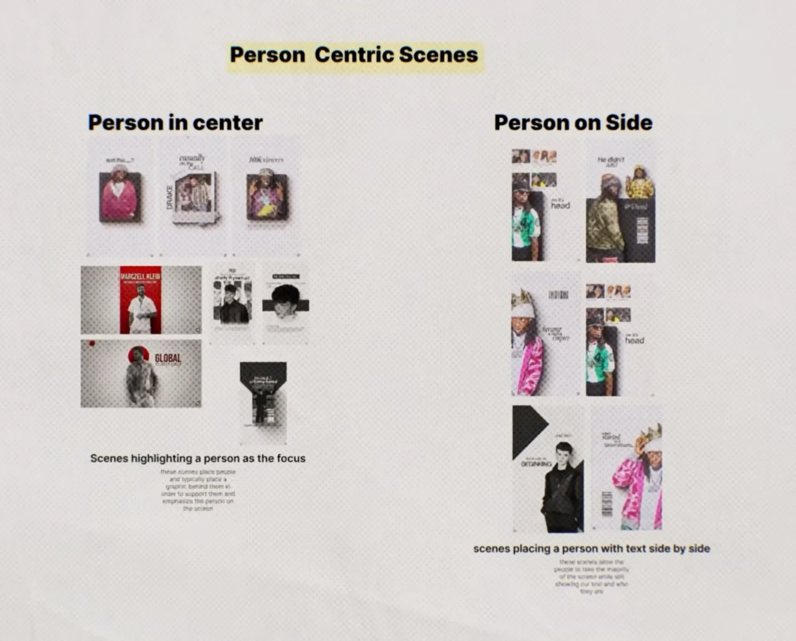
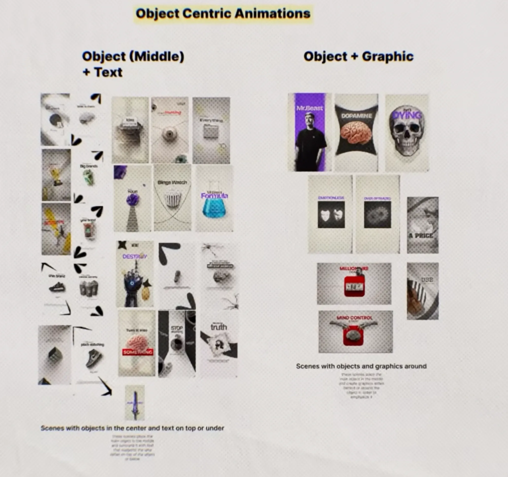
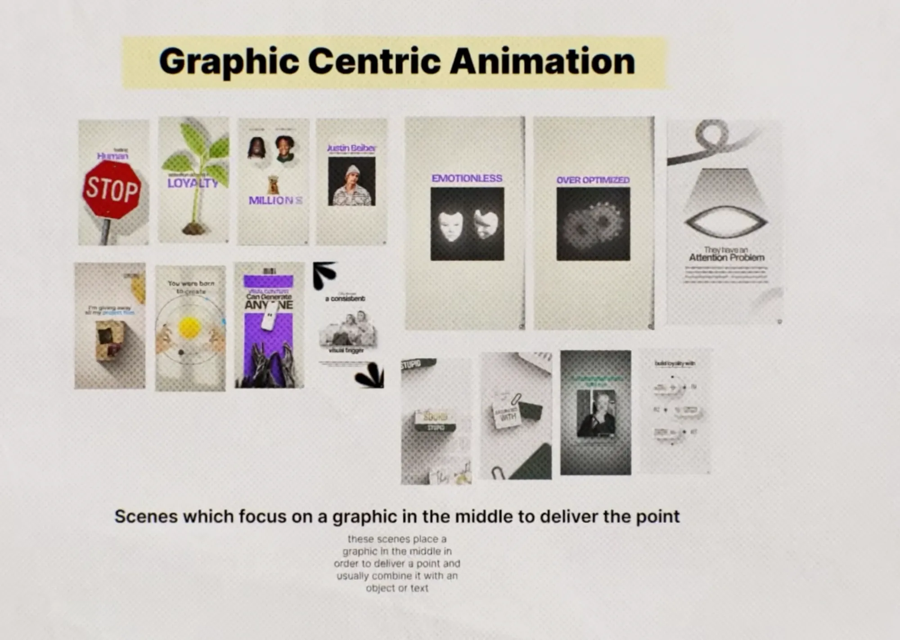

# 05: Animated Scene Types (motion graphic B-roll ki 4 families)

Talking head ke beech-beech me jo **animated scenes** aate hain (speaker ki jagah poora frame graphic ho jaata hai), unhe creator ne 4 families aur 9 types me baanta hai. Har scene me **ek hi main cheez** hoti hai: text, person, object, ya graphic. Baaki sab uska support karta hai.

> Slide ke chhote description text thode blur the. Neeche unka matlab likha hai, word-to-word nahi.

## Pura map

| Family | Type | Kya hota hai |
|--------|------|--------------|
| **Text** | 1. Text only | Text beech me, aur kuch nahi |
| | 2. Text + Object | Text screen ka zyada hissa leta hai; ek object side me/peeche, depth ke liye |
| | 3. Text + Graphic | Text beech me; aas-paas graphic shapes support karte hain |
| **Person** | 4. Person in center | Person beech me, peeche ek graphic (color block, circle, frame) jo use emphasize kare |
| | 5. Person on side | Person screen ka bada hissa leta hai; side me text + wo kaun hai |
| **Object** | 6. Object (middle) + Text | Object beech me; idea support karne wala text upar ya neeche |
| | 7. Object + Graphic | Object beech me; graphics peeche ya aas-paas, use emphasize karne ke liye |
| **Graphic** | 8. Graphic centric | Beech me ek graphic jo point deliver kare; aksar object ya text ke saath |

*(Creator ne 8 types dikhaye hain. Text family ke 3, baaki sab ke 2-2, graphic ka 1.)*

---

## 1. Text-centric

**Text only:** sirf text, beech me. Examples: "This is the **one**", "That's how you **WIN**", "The **Purple** rule is simple".
- Lesson 02–03 ka system yahan bhi: chhota sans setup + bada script/colored payoff.
- Text ke chaaron taraf **Figma jaisa selection box** (corner handles + cursor arrow), ya black **brush/ink swoosh** jo frame ke corner se aata hai. Khaali screen bhi designed lagti hai.

**Text + Object:** text hero hai, object secondary.
- Examples: "it lets you see **the future**" + cassette/camera; "life's **work**… lifetime" + sukhi bel (vine); "LOYAL fan base **596,000**" + person ka cutout side me.
- Object ko halka blur ya fade, ya frame ke edge par aadha bahar rakho. Isse depth aati hai.

**Text + Graphic:** text beech me, shapes support me.
- Examples: "Vertical Series" ko bade black brush strokes cut karte hain; "**FAIL**" ke peeche dark texture; "**GROUNDBREAKING**" ke upar-neeche purple rectangles.

## 2. Person-centric

**Person in center:** person ka cutout beech me, aur **peeche ek graphic**:
- Polaroid/photo frame (DRAKE wala, "casually on the CALL")
- Solid color block, jaise red rectangle ke saamne "MARCZELL KLEIN"
- Red circle, jaise "GLOBAL" wale me
- Black shape jisme person "khada" ho
- Upar chhota text: "and this…?", "100k viewers"

**Person on side:** person frame ka bada hissa (half ya usse zyada), ek side me.
- Doosri side **text** ("…it's **head**", "He didn't JUST…", "the BEGINNING").
- Upar ek **chhoti photo strip** (related logo/log ya reference) ho sakti hai.
- Naam/role bhi isi side me aa sakta hai. Viewer ko pata chalta hai ki ye kaun hai.

## 3. Object-centric

**Object (middle) + Text:** ek object beech me, text **upar ya neeche**, jo idea ko support kare.
- Examples: typewriter + "Idea"; eyeball + "hunting"; trophy; sneaker + "this brand"; popcorn + "**Binge Watch**"; flask + "MrBeast **Formula**"; brain + red label "**SOMETHING**"; robot haath + "**DESTROY**"; khaali frame + "**truth**".
- **Object = word ka literal visual.** "Binge Watch" bola to popcorn, "Formula" bola to flask, "Idea" bola to typewriter.

**Object + Graphic:** object beech me, aur graphic **peeche ya aas-paas**.
- Examples: MrBeast cutout + purple strip; brain + black star shape + "**DOPAMINE**"; skull + "**DYING**"; red button + "**MIND CONTROL**"; "**MILLIONAIRE**" + red box; "**A PRICE**"; "**USE**".

## 4. Graphic-centric

Beech me ek **graphic jo khud point bol de**, aksar object ya text ke saath.
- Examples: STOP sign + "being **Human**"; paudha + "**LOYALTY**"; chehre + "**MILLIONS**"; masks + "**EMOTIONLESS**"; dhundla circle + "**OVER OPTIMIZED**"; aankh ka shape + "They have an **Attention Problem**"; suraj aur orbit + "You were born to create"; purple block + "Can Generate **ANYONE**"; flowchart nodes + "build loyalty with…".

---

## Is style ka visual DNA (saare scenes me common)

| Element | Kaise dikhta hai |
|---------|------------------|
| Background | **Off-white paper** (~`#E9E6E0`), halftone dots + grain texture |
| Photos/objects | **Cutout** (background removed), zyada tar **black & white / desaturated** |
| Depth | Cutouts ke neeche **soft drop shadow**. Paper par chipke sticker jaise lagte hain |
| Accent | **Ek scene me ek hi color**: purple (~`#7B4DFF`), red (~`#D7262B`), ya green |
| Shapes | Black ink brush strokes, arrows, sparkle stars, circles, rectangles |
| UI elements | Figma jaisa selection box, cursor arrow, labels |
| Type | Bold grotesk sans (CAPS) + serif italic. Lesson 02 wala hi pairing |

Colors andaze se likhe hain. Slide par halftone overlay tha, isliye exact hex nahi mil sakta.

## Kaise banaye (mere suggestions)

1. **Background:** off-white solid + paper texture (Multiply) + halftone overlay (10–20%).
2. **Cutout:** CapCut "Remove BG" / Photoshop "Select Subject" / AE Roto Brush. Phir desaturate karo, contrast badhao.
3. **Shadow:** black, 25–35% opacity, distance 6–10px, softness 20–30px.
4. **Accent:** color block, circle ya highlight sirf ek color me.
5. **Animation:**
   - Object/person ko scale pop se lao (80% → 100%, ease-out, 8–10 frames).
   - Shapes slide in karein ya brush stroke "draw on" ho (Trim Paths / mask reveal).
   - Text word-by-word aaye (Lesson 02).
   - Halki si slow push-in (100% → 105%) poore scene par, taaki frame zinda lage.
6. **Duration:** ek scene **1.5–3 second**, phir wapas speaker ya agla scene.

## Script se scene kaise chune

Har line ke liye poochho: *"Is line ka hero kya hai?"*

| Line me hero kya hai | Scene type |
|----------------------|-----------|
| Ek strong word / quote | 1. Text only, ya 3. Text + Graphic |
| Word + uska context | 2. Text + Object |
| Kisi insaan ka naam / reference | 4. Person center, ya 5. Person side |
| Koi cheez jo dikhayi ja sake (popcorn, brain, money) | 6. Object + Text |
| Concept ko dramatic banana ho (dopamine, death, control) | 7. Object + Graphic |
| Abstract idea (loyalty, attention, emotionless) | 8. Graphic centric |

**Rule:** same type lagataar 2 baar mat lagao. Families badalte raho (text → object → person → graphic), taaki video me rhythm aur variety bani rahe.
