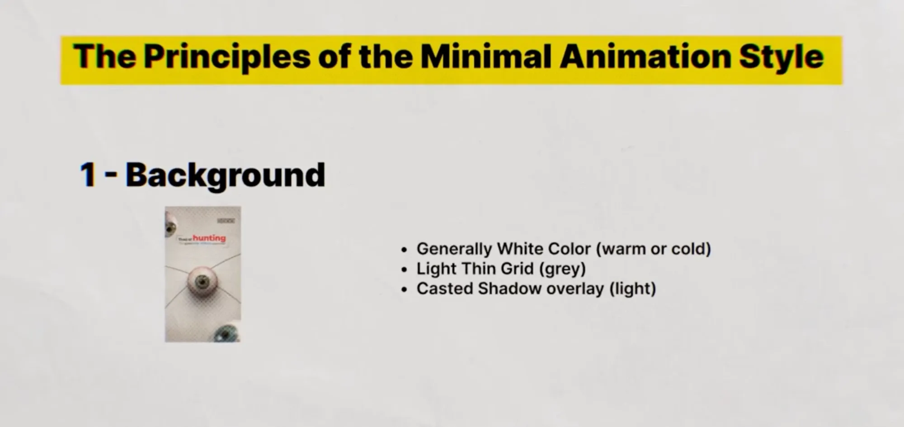
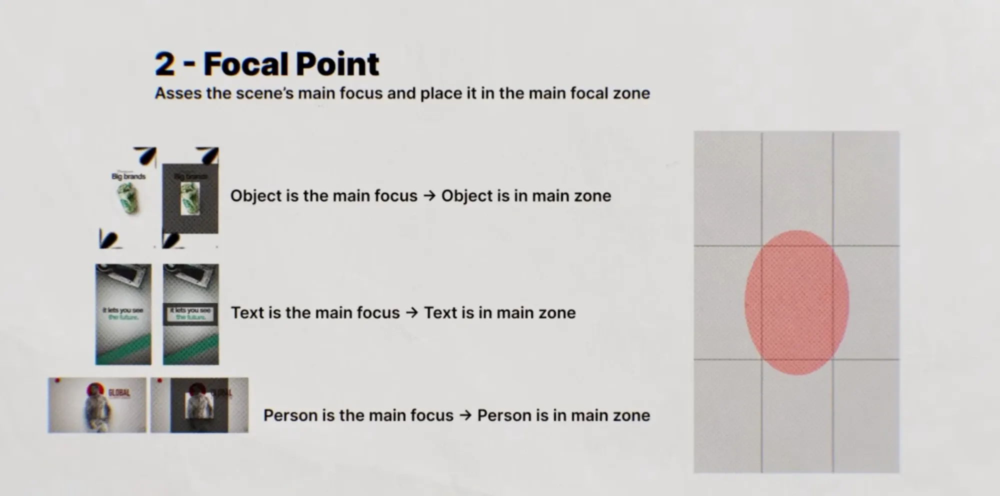
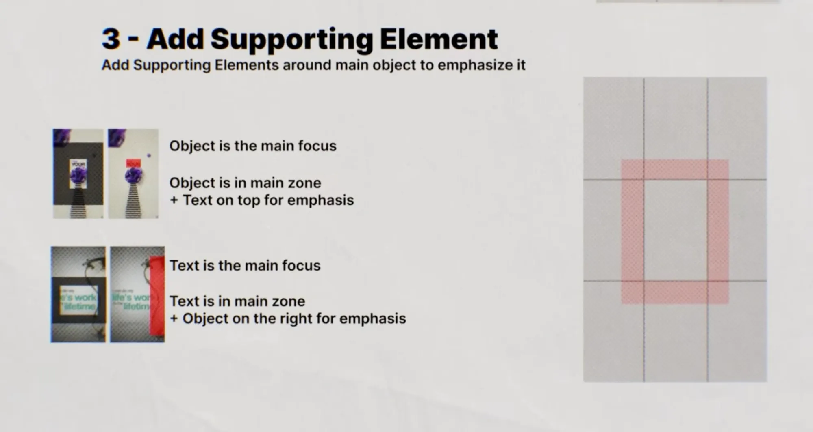
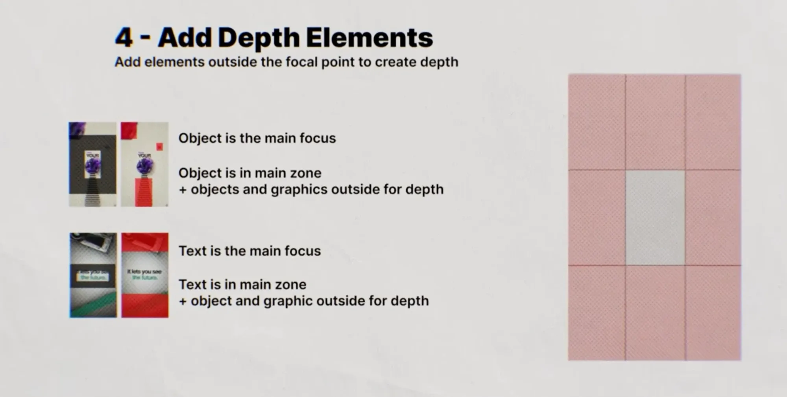
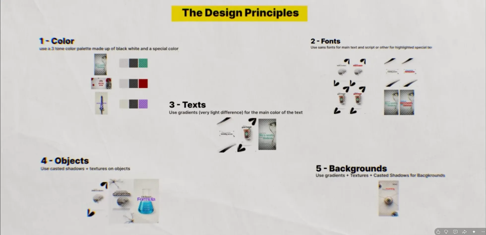
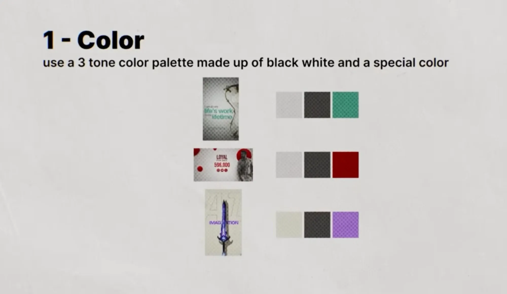
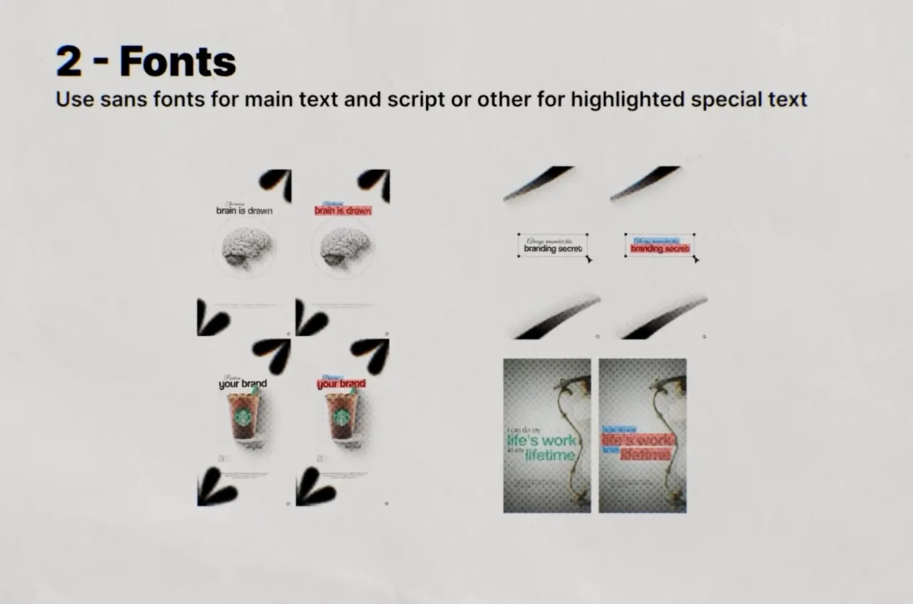
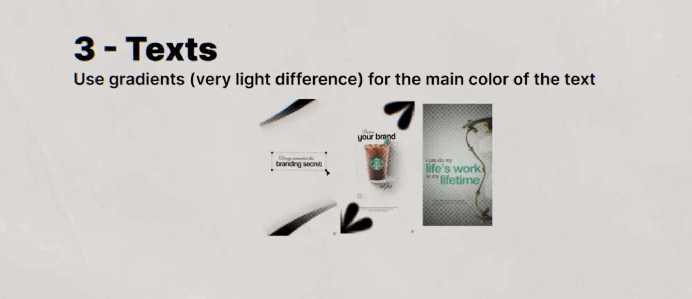
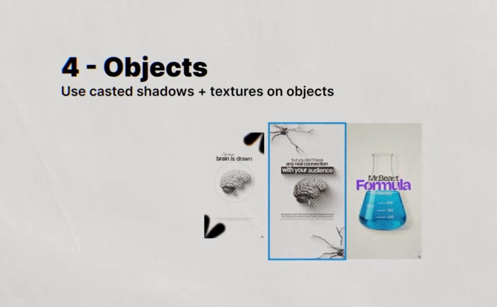
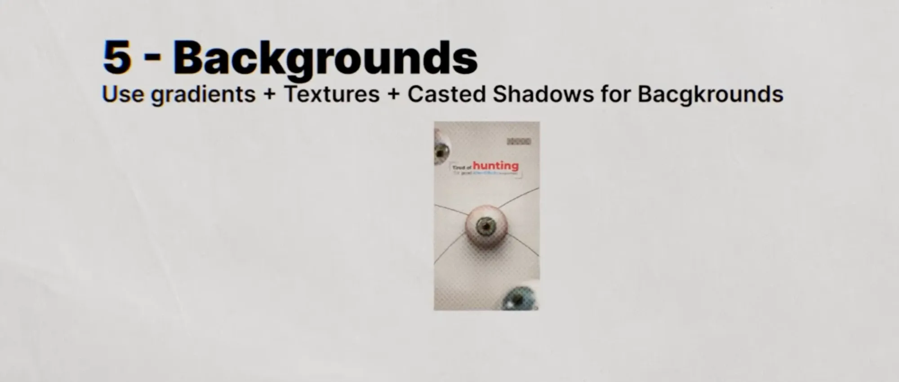

# 06: Minimal Animation Style: build process + design principles

**Source:** YouTube video *"How to Edit VIRAL Instagram Reels Using ONLY Claude! (New Style in 2026)"*, chapter "Training Claude: the visual guide (captions, animations, UI)". Lesson 01–05 bhi isi video se hain.

Lesson 05 me humne seekha ki **kaunse** scene types hote hain. Is lesson me seekhenge ki ek scene **kaise banta hai**: 4 build steps aur 5 design rules.

---

## Part A: Scene banane ke 4 steps

Frame ko **3×3 grid** me baanto (rule of thirds). Har step ka apna zone hai:

```
┌─────┬─────┬─────┐
│  4  │  4  │  4  │   4 = Depth zone (bahar ke 8 boxes)
├─────┼─────┼─────┤
│  4  │ 2/3 │  4  │   2 = Focal zone (beech ka box)
├─────┼─────┼─────┤   3 = Supporting ring (beech ke box ka border,
│  4  │  4  │  4  │       thoda bahar tak)
└─────┴─────┴─────┘
```

### Step 1: Background


- Zyada tar **white** (warm ya cold, video ke mood ke hisaab se)
- **Light thin grid**, grey color me
- **Casted shadow overlay**, light. Jaise khidki ya patton ki parchhai background par pad rahi ho

### Step 2: Focal point


> *"Assess the scene's main focus and place it in the main focal zone"*

- Pehle decide karo: is scene ka hero kya hai? **Object, text ya person?** (Lesson 05 ki families)
- Jo bhi hero hai, use **beech wale zone** me rakho. Oval shape, jo center box se thoda upar-neeche phaila hua hai.
  - Object hero hai → object beech me (cup + "Big brands")
  - Text hero hai → text beech me ("it lets you see the future")
  - Person hero hai → person beech me ("GLOBAL" wala)

### Step 3: Supporting element


> *"Add supporting elements around main object to emphasize it"*

- Hero ke **theek aas-paas** (center box ke border wale ring me) ek supporting element:
  - Object hero → **text upar**, emphasis ke liye ("YOUR" + purple object)
  - Text hero → **object right side me**, emphasis ke liye ("life's work" + red block/vine)
- Supporting element hero se chhota aur kam bright ho. Wo sirf hero ki taraf ishara kare.

### Step 4: Depth elements


> *"Add elements outside the focal point to create depth"*

- **Bahar ke 8 boxes** me (corners aur edges par) objects aur graphics, jo frame se aadhe bahar kate hue hon:
  - Red rectangles, color blocks
  - Cassette, camera, ya koi related object, kona kata hua
  - Brush strokes, arrows
- Ye kabhi beech me nahi aate. Sirf ek "layer" banate hain, taaki scene flat na lage.

**Yaad rakhne ka tareeka:** andar se bahar → **Hero → Support → Depth**, aur sabse peeche Background.

---

## Part B: 5 design principles



### 1. Color: 3-tone palette


> *"use a 3 tone color palette made up of black, white and a special color"*

| Scene | Light | Dark | Special color | Sampled (screenshot se) |
|-------|-------|------|---------------|-------------------------|
| life's work (vine) | light grey | charcoal | **Teal** | `#C2C0BE` · `#3D3A38` · `#3D8A72` |
| LOYAL fan base 596,000 | light grey | charcoal | **Deep red** | `#C2C0BE` · `#3B3A37` · `#7B0001` |
| IMAGINATION (sword) | **warm beige** | charcoal | **Lavender purple** | `#C8C7BA` · `#3E3C39` · `#9769BE` |

- Sampled colors swatches ke halftone dots ki wajah se thode **dark** aaye hain. Use karte waqt light ko `#E2E0DC` ke aas-paas aur accent ko thoda bright rakho (teal ~`#3FA585`, red ~`#8E0A0A`, purple ~`#A574D6`).
- Pure black nahi, **charcoal** (`#3C3A38`). Pure white nahi, **light grey ya beige**.
- Light color bhi mood ke hisaab se: cold grey (teal/red scenes) ya warm beige (purple scene).
- Sword scene me peeche **bahut bada, faded outline text** ("47"/"AI" jaisa) bhi hai. Ye bhi depth element hai.

### 2. Fonts


> *"Use sans fonts for main text and script or other for highlighted special text"*

Slide me har scene ke 2 versions hain. Right wale me **blue highlight = script** aur **red highlight = sans** dikhaya hai. Isse ek naya pattern dikhta hai:

```
  The human           ← tiny script (italic serif), blue
  brain is drawn      ← main sans, red

  Position            ← tiny script
  your brand          ← main sans

  Always remember this  ← tiny script
  branding secret       ← main sans

  I can do my           ← tiny script
  life's work           ← BADA sans, teal
  in my                 ← tiny script
  lifetime              ← BADA sans, teal
```

- Yahan script **chhota "kicker"** hai: connector words ("The human", "I can do my", "in my") script me, aur main idea sans me bada.
- Lesson 02 me ulta tha (keyword script me bada). **Dono chalte hain.** Rule sirf itna hai ki 2 fonts ka contrast ho:
  - Talking head captions → keyword script me (Lesson 02).
  - Animated scenes → main text sans, connector words tiny script me (ye lesson).

### 3. Texts: halka gradient


> *"Use gradients (very light difference) for the main color of the text"*

- Text ka color flat nahi. Upar se neeche **bahut halka gradient** (jaise "life's work" teal me upar thoda light, neeche thoda dark).
- Fark itna kam ho ki dikhe nahi, bas mehsoos ho. Isse text "printed" aur rich lagta hai.

### 4. Objects: casted shadow + texture


> *"Use casted shadows + textures on objects"*

- Brain ke neeche **casted shadow** (object ke shape jaisi parchhai, ek taraf giri hui), aur upar **halftone texture**.
- Flask: purple "Formula" text flask ke **upar overlap** karta hai, chhota "MrBeast" uske upar.
- Naye elements jo dikhe:
  - **Black label bar** me white text ("with your audience"). Highlight karne ka ek aur tarika.
  - Corners par **cracks / neuron jaisi lines**, depth ke liye (Part A ka step 4).
  - Brain ke peeche **patla circle** outline (supporting graphic).

### 5. Backgrounds: gradient + texture + casted shadow


> *"Use gradients + textures + casted shadows for backgrounds"*

- "Tired of **hunting** for good After Effects presets?" wala scene:
  - Background: beige gradient + halftone texture + halki casted shadow.
  - Beech me aankh (hero), usse **patli lines** chaaron taraf jaati hain (supporting graphic).
  - Corners par aur aankhein, **aadhi kati hui** (depth).
  - Text Figma jaise **selection box** me, "hunting" **red** me (special color).
- Ye ek scene me poora system dikhata hai: BG → hero → support → depth, aur 3 colors.

## Banane ke settings (mere suggestions, creator ne numbers nahi diye)

| Cheez | Setting |
|-------|---------|
| Grid | 1px lines, grey `#BDBDBD`, opacity 20–30%, 3×3 ya chhote squares |
| Casted shadow overlay | Leaf/window shadow PNG, Multiply, opacity 10–20%, blur 10–20px |
| Text gradient | Same color ke do shade, brightness me sirf 5–10% ka fark, upar light se neeche dark |
| Object casted shadow | Object ki copy → black fill → skew/rotate ek direction me → blur 15–25px → opacity 25–35% |
| Texture | Grain + halftone, Overlay/Soft Light, 10–20% |
| BG gradient | Center light, edges 5–10% dark (radial) |

## Checklist: har animated scene ke liye
- [ ] BG: off-white + thin grid + light casted shadow + halka gradient + texture
- [ ] Hero decide kiya (object / text / person) aur center zone me rakha
- [ ] Ek supporting element hero ke theek paas
- [ ] Depth elements bahar ke edges par, frame se aadhe kate hue
- [ ] Sirf 3 colors: off-white + charcoal + ek special color
- [ ] Main text sans, special word script
- [ ] Text me halka gradient
- [ ] Objects par casted shadow + texture
