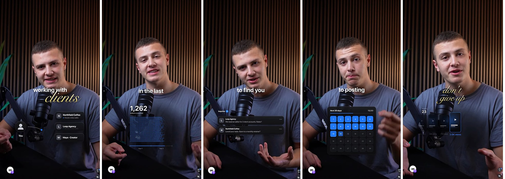
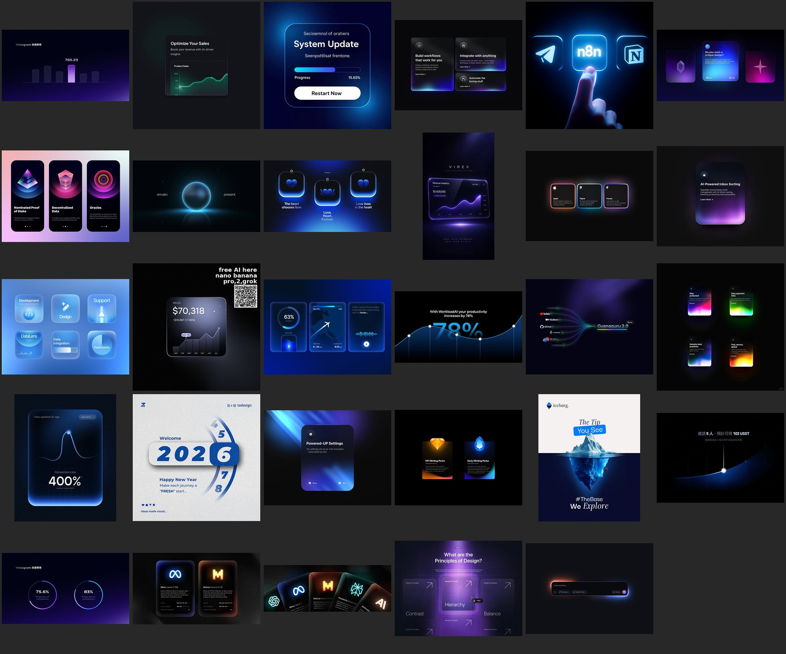

# 07: On-Screen UI Animation (speaker ke upar UI cards)



Talking head reel me speaker jo bol raha hai, wahi baat **ek chhote app/UI card** ki shakal me uske saamne (chest ke upar) animate hoti hai. Ye Lesson 05 ke full-screen animated scenes se alag hai: yahan **speaker frame me rehta hai**, aur UI uske upar float karta hai.

## 5 frames: bola kya, dikhaya kya

| Caption (bola) | On-screen UI (dikhaya) | Trick |
|----------------|------------------------|-------|
| "working with ***clients***" | "You" avatar → dotted line → client cards ki list (Northfield Coffee: *Needs video edits*, Loop Agency, Maya: Creator) | **Connection diagram**: aap aur aapke clients |
| "in the last" | **1,262** editors coached + blue **dot-matrix chart** (Year 1 → Year 2, dots bharte hue) | **Bada number + data** |
| "to find you" | **Inquiries (2)** notification cards: "Loop Agency: We need an editor for 3 client accounts. Rates?" | **Fake notification**, social proof |
| "to posting" | **Next 30 days 15/30** calendar, 14 din blue (posted), baaki grey | **Progress / consistency** |
| "***don't give up***" | **POSTS 23** + video thumbnails ki row, views badhte hue (332 → 778 → **3.6K views**), last wala highlight | **Payoff / result** |

**Sabse important:** har card wahi dikhata hai jo **us second bola ja raha hai**. Words aur visual 100% sync. UI decoration nahi, explanation hai.

**Continuity:** same fictional brands ("Northfield Coffee", "Loop Agency") alag scenes me dobara aate hain. Isse lagta hai ki ek hi kahani chal rahi hai, jaise ek asli app ka screen.

## Layout

```
┌─────────────────┐
│                 │
│   (face)        │  ← face hamesha khula
│                 │
│  working with   │  ← caption (Lesson 02: sans + gold script)
│     clients     │
│  ┌───────────┐  │
│  │  UI card  │  │  ← UI card: chest ke upar, caption ke neeche
│  └───────────┘  │
│                 │
└─────────────────┘
```

- **Caption upar, UI neeche.** Dono frame ke beech se neeche wale hisse me.
- UI card **mic ke upar bhi aa sakta hai**. Face kabhi cover nahi.
- Card ki width frame ka ~45–75%. Kabhi center, kabhi thoda ek side (client list right side me).
- **Background ko dark + blur karo, card ke peeche** (Nikhil ke brief ka rule): jab card screen par ho, frame ke neeche wale hisse par dark gradient (beech se neeche, black 0 → 50–60%) aur card ke peeche ki footage blur. Card ke saath hi fade in/out ho. Isse dark card aur white text saaf pop karte hain.

## UI card ka style



Zip ke 29 references (`assets/07-ui-kit/`) is style ki "UI kit" hain:

| Element | Style |
|---------|-------|
| Card BG | Dark glass, ~`#15171C` at 80–90% opacity, halka background blur |
| Border | 1px, white 8–15% opacity, corner radius 12–20px |
| Accent | **Ek hi**: electric blue ~`#2F6BFF` (reels me). Kit me violet, neon green, orange bhi |
| Text | Chhota white sans (Inter/SF Pro), labels grey `#8A8F98` |
| Icons | Letter avatars (N, L, M) rounded squares me, ya simple line icons |
| Glow | Active element (selected thumbnail, filled dots, progress bar) par halka blue glow |
| Numbers | Bade aur bold (1,262 / 15/30 / 3.6K), saath me chhota label |

**Reusable card types (kit se):**
- List / inbox (clients, inquiries, tasks)
- Stat card: bada number + chhota chart
- Calendar / progress grid
- Thumbnail row (videos, posts)
- Connection / flow diagram (avatar → dotted line → items)
- Progress bar + button ("System Update, Restart Now")
- Glowing app icons row (n8n, Notion, Telegram)
- Prompt / search bar ("Ask anything…")
- Ring charts (75.6%, 83%)

## Animation (mere suggestions, frames se andaza)

1. **Card entry:** neeche se 20–30px upar + fade + halka blur → sharp (Lesson 02 wala hi motion), 8–12 frames, ease-out.
2. **Andar ke items stagger:** list items / thumbnails / calendar cells ek-ek karke, 2–3 frames ke gap se.
3. **Data animate:** number count-up (0 → 1,262), dots ya cells bharte hue (blue fill), progress bar badhta hua, views count badhte hue.
4. **Connector line:** dotted line avatar se cards tak "draw on" hoti hai.
5. **Highlight:** last ya important item par blue border + glow pop (3.6K views wala thumbnail).
6. **Exit:** jab baat badle, card fade + thoda neeche (6 frames). Ek time par **ek hi card**.
7. Har card screen par 1.5–3 second.

## Kaise banaye

- **Design:** Figma me card banao (UI kit references se), PNG/SVG export, ya har element alag layer me.
- **Animate:** After Effects (best: stagger, count-up, Trim Paths), ya CapCut me har layer ka keyframe.
- **Code se (video ka main idea, "using only Claude"):** HTML/CSS ya Remotion me card banake animate karo, transparent video export karo, aur speaker ke upar overlay karo.

## Checklist
- [ ] Card exactly wahi dikhaye jo us second bola ja raha hai
- [ ] Caption upar, card neeche, face khula
- [ ] Dark glass card, 1px light border, ek accent color
- [ ] Bada number + chhota label
- [ ] Items stagger hokar aayein, data animate ho
- [ ] Ek time par ek card, 1.5–3s
- [ ] Same fictional brands/names poore video me (continuity)
