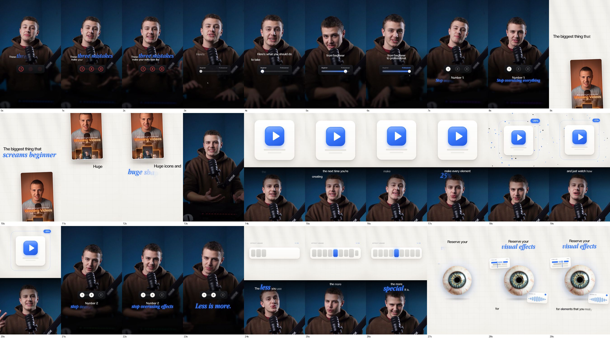
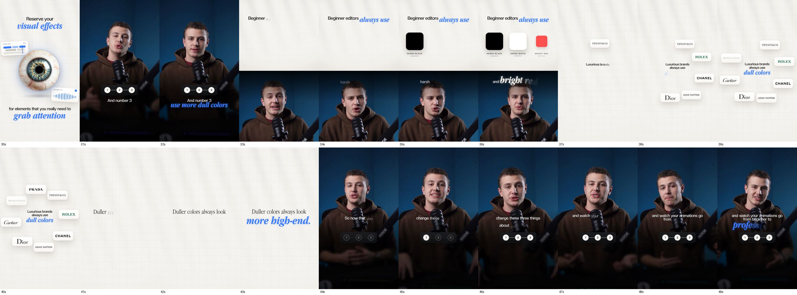
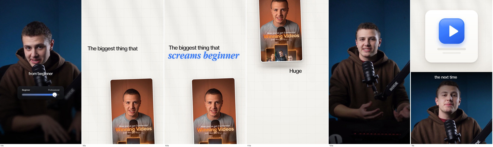
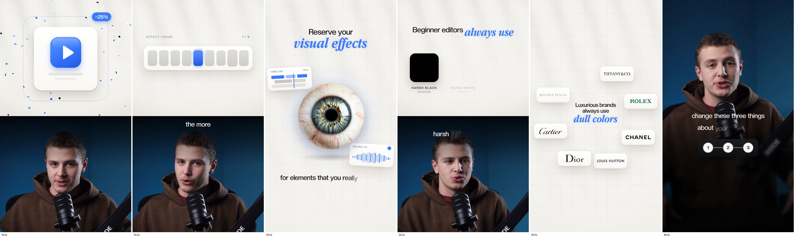

# 08: 3 kinds of animations + Video-centric scenes (research se mila)

**Source:** Joseph Eid (YouTube: *Joseph | Video Editing*), video *"How to Edit VIRAL Instagram Reels Using Opus 5.5! (New Style in 2026)"* (`5UnK3c-nlIs`). Uski description me ek free Google Drive folder hai: <https://drive.google.com/drive/folders/1WJMeuTvYZJgufE9_Xpkp6xThzQWXhR-G>. Usme final edit `3 things - Edit v1 + SFX.mp4` (50 sec) hai. Ye lesson us edit ko frame-by-frame dekh ke bana hai.

> Asli "visual guide" PDF paid course (Ultimate Editors 2.0) ke andar hai, free nahi hai. Isliye ye rules final edit dekh ke nikaale gaye hain. Video description me bhi likha hai: *"Claude used Remotion to build the full screens, half screens, UIs, zooms and camera moves."*




## 3 kinds of animations




| Kind | Frame kaisa dikhta hai | Edit me kahan |
|------|------------------------|---------------|
| **1. On-screen (UI)** | Speaker poora frame me. Neeche ka hissa **dark aur blur**, upar caption, uske neeche ek chhota dark glass UI | 0–8s, 20–23s, 31–32s, 44–49s |
| **2. Half-screen** | Frame **2 hisson me**: upar ~50% white paper scene (animation), neeche ~50% speaker (crop, face center me). Caption speaker wale hisse ke upar | 14–20s, 24–26s, 33–36s |
| **3. Full-screen** | Speaker gayab. Poora frame off-white paper + grid scene (Lesson 05–06 wala) | 9–12s, 27–30s, 37–43s |

Iske alawa: **zoom / camera move** speaker par (13s: speaker bada hokar aata hai), scenes ke beech.

### 1. On-screen (UI)
- UI chhota hai: **dark glass pill** (`rgba(20,22,28,0.85)`), radius bada, halka border.
- Edit me 2 UI aate hain:
  - **Slider "Beginner → Professional":** handle left se right khiskata hai, bar blue bharta hai (cursor ke saath).
  - **Stepper ① — ② — ③:** baat jis number par hai, wo white circle bhar jaata hai. Ye poore video me **3 baar wapas aata hai**, jaise video ka table of contents. Har baar ek step aage, aur end me teeno bhare hue (recap).
- Speaker ka neeche wala hissa (haath, hoodie) dark aur blur ho jaata hai, isliye UI aur caption saaf padhe jaate hain.
- Caption: white sans ("Number 1:") + neeche bada **blue script** ("Stop oversizing everything").

### 2. Half-screen
- Upar: white paper + grid, beech me ek object ya UI, bada aur saaf:
  - App icon (blue play button wala white card), jo phir chhota hota hai, "**−25%**" badge aur particles ke saath (baat: "make every element 25% smaller")
  - "EFFECT USAGE 1/9" slider: 9 segments, sirf ek blue (baat: "the less you use, the more special it is")
  - Color swatches: HARSH BLACK `#000000`, HARSH WHITE, BRIGHT RED, ek-ek karke pop
- Neeche: speaker crop. Caption speaker ke sir ke upar.
- Kab: jab baat ka visual chahiye **par speaker ka expression bhi zaroori ho**.

### 3. Full-screen
- Background: off-white `~#F1EFEA`, **patla grid** (light grey lines), aur **khidki jaisi diagonal casted shadows** (halki). Lesson 06 ka "Background" rule.
- Text: black sans ("The biggest thing that") + **blue bold italic serif** ("screams beginner"). Is video ka accent blue hai, kyunki studio ka background bhi blue hai (Lesson 03 ka rule: accent footage se lo).
- Examples:
  - **Object + UI cards:** realistic aankh beech me (casted shadow ke saath), side me chhote UI cards ("TIMELINE", "SOUND FX" waveform). Text upar "Reserve your *visual effects*", neeche "for elements that you really need to *grab attention*".
  - **Text + logo cards:** beech me "Luxurious brands always use *dull colors*", aas-paas white cards me brand logos (Tiffany, Rolex, Chanel, Dior, Cartier, LV, Bottega, Prada), ek-ek karke pop.
  - **Text only:** "Duller colors always look *more high-end.*" (serif, bada).

## Video-centric scenes

Edit me 9–12s par: **"The biggest thing that *screams beginner*"**

- Hero = **ek video clip** (creator ki purani reel "Winning Videos"), ek **rounded card** ke andar (radius ~16px, patla white border, neeche soft drop shadow), **thoda tilt**.
- Card frame me **neeche se upar slide** karta hai (camera pan jaisa), aur text uske saath badalta hai ("Huge", "Huge icons and *huge shapes*").
- Background wahi paper + grid.

**Video-centric ke rules (is edit se nikaale):**
1. Video clip hi hero hai: B-roll, purani reel, screen recording, ya example video.
2. Clip ko card ya phone frame me rakho. Rounded corners, border, shadow. Kabhi poora frame nahi.
3. Halka tilt (2–5°) aur slow move (slide, pan, ya push-in). Video static nahi rehta.
4. Text upar ya side me (Lesson 05 ke text rules), sans + script.
5. Clip ke andar ka audio mute, voice-over chalta rahe.

## Edit ka rhythm (50 sec, 3 tips)

```
0s   On-screen   Hook: "These three mistakes make your edits look like…" + stepper ①②③
4s   On-screen   Slider: Beginner → Professional
7s   On-screen   "Number 1: Stop oversizing everything" (stepper ①)
9s   FULL        Video-centric: purani reel card + "screams beginner"
13s  Zoom        Speaker close-up
14s  HALF        App icon −25%
20s  On-screen   "Number 2: stop overusing effects" (stepper ②)
24s  HALF        Effect usage slider
27s  FULL        Aankh + UI cards: "Reserve your visual effects"
31s  On-screen   "And number 3: use more dull colors" (stepper ③)
33s  HALF        Harsh black / white / bright red swatches
37s  FULL        Luxury brand logos: "dull colors" → "more high-end"
44s  On-screen   Recap: stepper ①②③ sab bhare, "from beginner to professional"
```

**Pattern:**
- Har tip ka structure same hai: **On-screen (number) → Half/Full (visual proof) → wapas speaker.**
- Lagbhag har 3–5 second me naya visual.
- Same kind lagataar 2 baar nahi.
- Stepper poore video ko ek dhaage me baandhta hai (continuity, Lesson 07).
